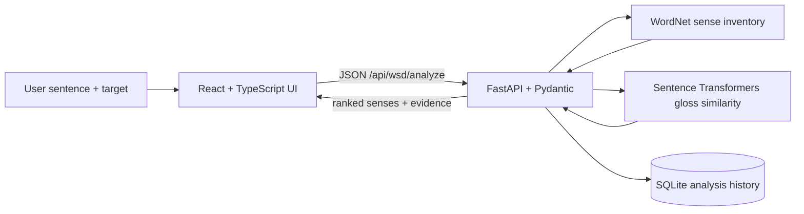

# SenseAI

SenseAI is a locally runnable word sense disambiguation app. Enter a sentence or paragraph and the ambiguous word; the API compares the surrounding context with WordNet definitions and returns ranked candidate senses, examples, synonyms, part of speech, and an honest ranking explanation. It also supports batch analysis, CSV export, and SQLite history.

For public hosting, follow [DEPLOY.md](DEPLOY.md). GitHub stores the code; the frontend and API must be hosted as separate services.

For the simpler one-page version with no login or Node.js setup, see [BASIC_README.md](BASIC_README.md). Run `uvicorn basic_app:app --host 127.0.0.1 --port 8000` and open `http://127.0.0.1:8000`.

## Local sign-in

The first screen is sign-in. On first use, choose **Create an account** and enter an email address plus a password of at least 8 characters. Accounts and analyses stay in the local SQLite database; passwords are stored as salted PBKDF2-SHA256 hashes. Sign-in sessions expire after 12 hours and are kept in the browser tab's session storage. There is no password reset, so keep the password you choose.

## Architecture and data flow



The backend keeps the transformer loaded in process and stores only analyses in the local SQLite database. The primary ranking method encodes the supplied sentence context and WordNet glosses with `sentence-transformers/all-MiniLM-L6-v2`, then ranks by cosine similarity. This is a ranking signal, not a calibrated probability or a faithful feature attribution. If the transformer cannot load, a clearly labeled lexical overlap fallback is used. Unknown words return an unknown result. No paid API or credentials are needed.

## Windows PowerShell setup

Prerequisites: Python 3.10–3.12, Node.js 20+, and internet access for initial package and model downloads. The model is downloaded from Hugging Face on first analysis (roughly 90 MB, plus PyTorch dependencies); WordNet data is downloaded once. CPU inference works, with slower response on older hardware. Python package installation can use several GB of temporary disk space because of PyTorch.

From the project directory:

```powershell
py -3.11 -m venv .venv
.\.venv\Scripts\Activate.ps1
python -m pip install --upgrade pip
pip install -r requirements.txt
python -m nltk.downloader wordnet omw-1.4
Copy-Item .env.example .env
uvicorn backend.main:app --reload --host 127.0.0.1 --port 8000
```

In a second PowerShell window, from the same directory:

```powershell
npm install
npm run dev
```

Open the Vite URL shown in the terminal (normally `http://localhost:5173`). API documentation is available at `http://127.0.0.1:8000/docs`.

### Troubleshooting

- If PowerShell blocks activation, run `Set-ExecutionPolicy -Scope Process -ExecutionPolicy Bypass` in that window and activate again.
- If you see an NLTK WordNet message, activate the venv and rerun `python -m nltk.downloader wordnet omw-1.4`.
- If transformer download is unavailable, the service logs a warning and uses WordNet gloss word overlap. The result labels this fallback, and its scores are not probabilities. To explicitly use this mode: `$env:SENSEAI_DISABLE_TRANSFORMER = "1"` before starting Uvicorn.
- If port 8000 or 5173 is occupied, pass another `--port` to Uvicorn or change Vite's `server.port` in `vite.config.ts`.
- To use another local model, set `SENSEAI_MODEL` to a compatible Sentence Transformers model identifier before starting the backend.

## API

- `GET /api/health` — reports WordNet and service status.
- `POST /api/auth/register` and `POST /api/auth/login` — local account creation and sign-in; return a 12-hour bearer session.
- `GET /api/auth/me` and `POST /api/auth/logout` — inspect or revoke the signed-in session.
- `POST /api/wsd/analyze` — authenticated JSON body `{ "text": "...", "target": "...", "occurrence": 1 }`.
- `POST /api/wsd/batch` — authenticated `{ "items": [{ "text": "...", "target": "..." }] }`.
- `GET /api/wsd/history?limit=50` and `DELETE /api/wsd/history` — the signed-in account's local history.
- `POST /api/evaluation/run` — authenticated and accepts user-provided `{ "items": [...], "labels": ["word.n.01"], "dataset": "..." }`; computes accuracy, per-class precision/recall/F1, macro-F1, and confusion matrix from the submitted labels. It does not claim benchmark results.

The API permits local development origins and the exact production origin set in `FRONTEND_ORIGIN`. Set `DATABASE_URL` to change the SQLite location. Set `LOG_LEVEL` to control server logging.

## Tests

With the backend virtual environment activated, run:

```powershell
pytest
```

The integration tests cover financial/river senses of “bank,” animal/sports senses of “bat,” repeated occurrences, unknown words, and request validation. Sense tests require the WordNet download described above. Tests disable transformer loading so they are fast and do not download the model.

## Report outline

1. Abstract
2. Problem statement and objectives
3. Existing system limitations
4. Proposed system and user workflow
5. Methodology: WordNet candidate inventory, context encoding, gloss similarity, and fallback
6. Architecture and data flow
7. Implementation and API
8. Evaluation: dataset, sample count, class distribution, accuracy, precision, recall, F1, confusion matrix, and limitations
9. Limitations: English WordNet coverage, gloss ranking, CPU/model download needs, no calibrated confidence, and the fallback's weaker evidence
10. Future scope: validated multilingual sense mappings, benchmark-based model comparison, and curated practice exercises

## Current scope

The interface supports analysis, batch runs with CSV export, a context-led sense explorer, user-labeled evaluation with a confusion matrix, a short learning guide, and local history. Evaluation uses only labels and examples supplied by the user; the UI does not show fabricated benchmark metrics. A built-in most-frequent-sense comparison, Hindi and Telugu WSD, semantic graph visualization, and a bundled labeled evaluation corpus are not claimed as implemented.
